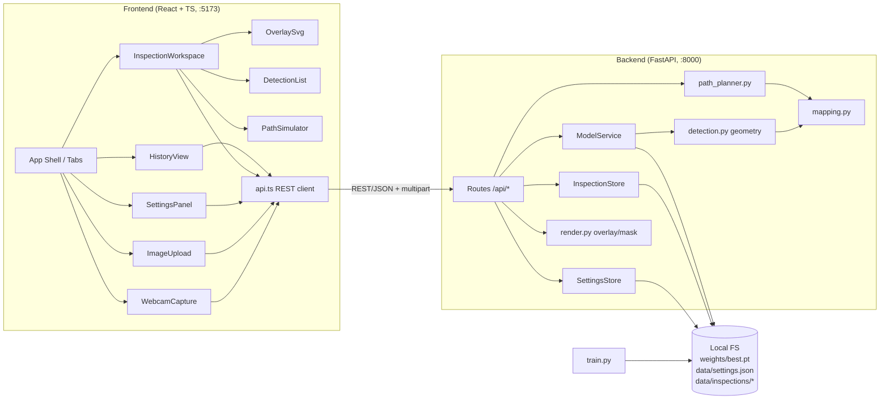
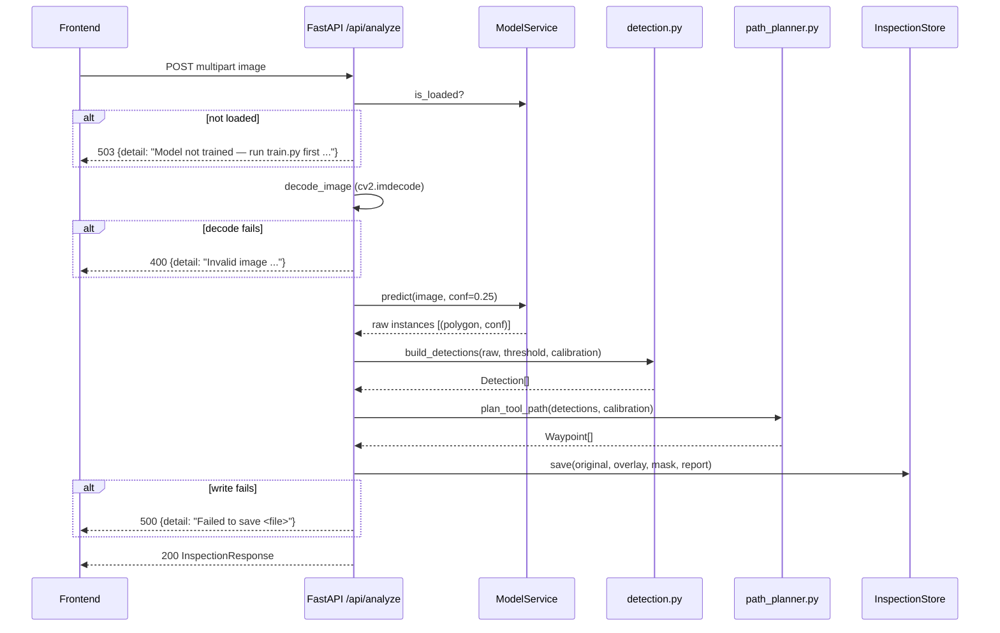

# Design Document: CrackBot AI

## Overview

CrackBot AI is a local, two-process web application for a hackathon demo:

- **Backend** (Python 3.11+, FastAPI, Ultralytics YOLO11n-seg, PyTorch, OpenCV, NumPy) on `http://localhost:8000`. It loads the fine-tuned `best.pt` once, runs crack segmentation, computes per-crack geometry, maps pixels to arm millimeters with a fixed scale + offset, plans a tool path, and saves every inspection to disk as images + a JSON report.
- **Frontend** (React + TypeScript + Vite + Tailwind) on `http://localhost:5173`. It captures a webcam snapshot or accepts an upload, calls the Backend over REST, draws outlines/boxes/path with an SVG overlay, animates a simulated tool marker along the path, and browses inspection history.
- **Training_Script** (`backend/train.py`) fine-tunes `yolo11n-seg.pt` on Ultralytics `crack-seg.yaml` and copies the best weights to `backend/weights/best.pt`.

There is no fallback detector. If `best.pt` is missing, the Backend still starts, `/api/status` reports `model_loaded: false`, `/api/analyze` returns 503 with a "run train.py first" message, and the Frontend shows a banner and disables Analyze.

Key design decisions:

| Decision | Choice | Rationale |
|---|---|---|
| Overlay rendering | SVG absolutely positioned over ``, `viewBox = 0 0 width height` | Resolution-independent, scales with the image, easy to test, no manual canvas redraws |
| Mask source | Ultralytics `result.masks.xy` polygons rasterized at original resolution with `cv2.fillPoly` | Avoids letterbox/rescale math on `masks.data`; outline is directly available |
| Skeleton | Iterative morphological skeleton with OpenCV (`erode`/`dilate`/`subtract`) | Pure OpenCV, no `opencv-contrib` or scikit-image dependency |
| Crack length | Skeleton pixel count | Simple, monotone, adequate for MVP |
| Waypoint order within a crack | Sort skeleton points by projection onto principal axis (PCA), uniform subsample to ≤ 50 | Cracks are mostly elongated; deterministic and cheap |
| Detection order | Greedy nearest-neighbor on centroid Arm_Coordinates, starting from the centroid nearest arm origin (0, 0) | Matches Requirement 7.3 exactly |
| Simulation | Pure TypeScript reducer driven by `requestAnimationFrame` | Logic is testable without a DOM |
| Storage | `backend/data/inspections/<id>/` + `backend/data/settings.json` | Local filesystem + JSON per constraints |
| Testing | Backend: pytest + Hypothesis. Frontend: Vitest + fast-check + React Testing Library | Standard PBT libraries for each language |

## Architecture



### Analyze request flow



### Project layout

```
backend/
  app/
    __init__.py
    main.py            # FastAPI app, CORS, routes, startup
    config.py          # paths, defaults, constants
    schemas.py         # Pydantic models
    model_service.py   # load best.pt once, device select, predict
    imaging.py         # decode_image, file type helpers
    detection.py       # mask -> outline, bbox, centroid, area, skeleton, length
    mapping.py         # pixel -> arm, length/area scaling
    path_planner.py    # waypoint sampling + nearest-neighbor ordering
    render.py          # overlay + mask images
    settings_store.py  # load/save settings.json
    inspection_store.py# create id, save files, list, load
  train.py
  weights/             # best.pt (git-ignored)
  data/                # settings.json, inspections/ (git-ignored)
  tests/
  requirements.txt
frontend/
  src/
    main.tsx, App.tsx
    api.ts             # typed REST client
    types.ts           # shared TS types mirroring schemas.py
    lib/
      validation.ts    # isSupportedImage, validateCalibration, canAnalyze
      simulation.ts    # pure simulator reducer
    components/
      ModelBanner.tsx
      WebcamCapture.tsx
      ImageUpload.tsx
      SettingsPanel.tsx
      InspectionWorkspace.tsx
      OverlaySvg.tsx
      DetectionList.tsx
      PathSimulator.tsx
      WaypointList.tsx
      HistoryView.tsx
  tests/ (or *.test.ts colocated)
  package.json, vite.config.ts, tailwind.config.ts
README.md
```

## Components and Interfaces

### Backend REST API

All routes are prefixed with `/api`. Errors use FastAPI's `{"detail": "<message>"}` body.

| Method | Path | Request | Response | Errors |
|---|---|---|---|---|
| GET | `/api/status` | – | `StatusResponse` | – |
| GET | `/api/settings` | – | `CalibrationSettings` | – |
| PUT | `/api/settings` | `CalibrationSettings` JSON | `CalibrationSettings` | 422 invalid values |
| POST | `/api/analyze` | multipart `file` | `InspectionResponse` | 503 model not loaded, 400 invalid image, 500 save failure |
| GET | `/api/inspections` | – | `InspectionSummary[]` newest first | – |
| GET | `/api/inspections/{id}` | – | `InspectionResponse` | 404 not found / invalid report |
| GET | `/api/inspections/{id}/files/{name}` | – | image file | 404 |

`{id}` must match `^[0-9]{8}T[0-9]{6}_[0-9a-f]{8}$` and `{name}` must be one of `original.png`, `overlay.png`, `mask.png`; anything else returns 404. This blocks path traversal.

CORS allows origins `http://localhost:5173` and `http://127.0.0.1:5173`. The app is local-only and unauthenticated by design; uvicorn binds to `127.0.0.1` so it is not exposed on the network.

### Backend modules

```python
# config.py
BACKEND_DIR = Path(__file__).resolve().parent.parent
WEIGHTS_PATH = BACKEND_DIR / "weights" / "best.pt"
DATA_DIR = BACKEND_DIR / "data"
SETTINGS_PATH = DATA_DIR / "settings.json"
INSPECTIONS_DIR = DATA_DIR / "inspections"
DEFAULT_CONFIDENCE = 0.25
MAX_WAYPOINTS_PER_DETECTION = 50
MODEL_NOT_LOADED_MSG = "Model not trained — run train.py first (expected weights at {path})"
```

```python
# model_service.py
@dataclass
class RawInstance:
    polygon: np.ndarray   # (N, 2) float32 pixel coords at original resolution
    confidence: float

class ModelService:
    def __init__(self, weights_path: Path): ...
    def load(self) -> None:
        """Load YOLO(weights_path) once if file exists; else leave model None. Never raises on missing file."""
    @property
    def is_loaded(self) -> bool: ...
    @property
    def device(self) -> str:  # "cuda:0" if torch.cuda.is_available() else "cpu"
    def predict(self, image_bgr: np.ndarray, conf: float) -> list[RawInstance]:
        """Run model(image, conf=conf, device=self.device, retina_masks=True, verbose=False)
        and convert result.masks.xy + result.boxes.conf to RawInstance list."""

def select_device() -> str: ...
```

`ModelService` is created in FastAPI's lifespan handler and stored on `app.state`. A `threading.Lock` around `predict` keeps inference serialized (demo is single-user). The `/api/analyze` handler is a plain `def` (not `async def`) so FastAPI runs the blocking inference and disk writes in its threadpool instead of stalling the event loop.

```python
# imaging.py
class InvalidImageError(ValueError): ...
def decode_image(data: bytes) -> np.ndarray:
    """cv2.imdecode(np.frombuffer(data, np.uint8), cv2.IMREAD_COLOR); raise InvalidImageError
    if result is None or data is empty."""
```

```python
# mapping.py
def to_arm(px: float, py: float, cal: CalibrationSettings) -> ArmPoint:
    return ArmPoint(x=round(px * cal.mm_per_pixel + cal.offset_x, 2),
                    y=round(py * cal.mm_per_pixel + cal.offset_y, 2))
def length_to_mm(length_px: float, cal) -> float:  # round(length_px * s, 2)
def area_to_mm2(area_px: float, cal) -> float:     # round(area_px * s * s, 2)
```

```python
# detection.py
@dataclass
class DetectionGeometry:
    mask: np.ndarray            # uint8 HxW, 0/1
    outline: list[tuple[int,int]]
    bbox: tuple[int,int,int,int]  # x_min, y_min, x_max, y_max (inclusive)
    centroid: tuple[float,float]
    area_px: int
    skeleton_points: np.ndarray # (K, 2) int (x, y)
    length_px: float

def rasterize(polygon: np.ndarray, h: int, w: int) -> np.ndarray
def compute_geometry(mask: np.ndarray) -> DetectionGeometry | None   # None if mask empty
def skeletonize(mask: np.ndarray) -> np.ndarray                      # morphological skeleton
def build_detections(raw: list[RawInstance], h: int, w: int,
                     threshold: float, cal: CalibrationSettings) -> tuple[list[Detection], list[DetectionGeometry]]
```

Geometry rules:
- `outline`: largest external contour from `cv2.findContours(mask, RETR_EXTERNAL, CHAIN_APPROX_SIMPLE)`.
- `bbox`: min/max of mask pixel coordinates (`np.nonzero`), inclusive.
- `centroid`: mean of mask pixel coordinates (`cv2.moments` m10/m00, m01/m00).
- `area_px`: `int(mask.sum())`.
- `rasterize`: polygons with fewer than 3 points (Ultralytics can return empty `masks.xy` entries) yield an empty mask without calling `cv2.fillPoly`.
- `skeleton`: crop the mask to its bbox and pad by 1 zero pixel on every side (`cv2.copyMakeBorder`, `BORDER_CONSTANT`, value 0), then iterate `eroded = erode(img)`, `opened = dilate(eroded)`, `skel |= img - opened`, `img = eroded` until `img` is empty; map points back to full-image coordinates. The zero padding is required: OpenCV's default erode border never erodes from the image edge, so a mask touching all edges would loop forever. Cropping keeps it fast on large webcam frames. If the skeleton is empty (tiny blob), use the centroid pixel as the single skeleton point.
- `length_px`: number of skeleton pixels (≥ 1).
- Instances with `confidence < threshold` or an empty rasterized mask are dropped. Detection `index` is assigned 0..n-1 in descending confidence order.

```python
# path_planner.py
def sample_skeleton(points: np.ndarray, max_points: int = 50) -> np.ndarray:
    """Sort by projection onto first principal axis, then pick
    np.linspace(0, len-1, min(len, max_points)).round() unique indices."""
def order_detections(centroids_arm: list[ArmPoint]) -> list[int]:
    """Greedy NN: start = argmin |c| to (0,0); next = argmin distance to current centroid
    among unvisited; ties broken by lower index."""
def plan_tool_path(detections: list[Detection], geoms: list[DetectionGeometry],
                   cal: CalibrationSettings) -> list[Waypoint]:
    """For each detection in NN order, take its sampled points; reverse them if the last
    point is closer to the previous tool position than the first. Emit Waypoints with
    sequential index, pixel, arm (via to_arm), detection_index."""
```

```python
# render.py
def render_overlay(image_bgr, geoms) -> np.ndarray   # 40% red mask fill + green outline + yellow bbox
def render_mask(h, w, geoms) -> np.ndarray           # uint8 0/255 union of masks
```

```python
# settings_store.py
class SettingsStore:
    def __init__(self, path: Path): ...
    def load(self) -> CalibrationSettings:
        """Return parsed settings; on missing file, OSError, JSONDecodeError or ValidationError,
        log warning and return defaults (1.0, 0.0, 0.0)."""
    def save(self, cal: CalibrationSettings) -> None:  # write temp file then os.replace
    current: CalibrationSettings                       # in-memory, used by /api/analyze
```

```python
# inspection_store.py
class InspectionSaveError(Exception):
    def __init__(self, filename: str): ...
class InspectionStore:
    def __init__(self, root: Path): ...
    def new_id(self, now: datetime) -> str:   # now.strftime("%Y%m%dT%H%M%S") + "_" + uuid4().hex[:8]
    def save(self, report: InspectionReport, original, overlay, mask) -> None:
        """mkdir(exist_ok=False); write original.png, overlay.png, mask.png via cv2.imwrite
        (False -> InspectionSaveError(name)); write report.json. Any OSError -> InspectionSaveError(name)."""
    def list(self) -> list[InspectionSummary]:
        """Scan subdirs; parse report.json with InspectionReport.model_validate_json; skip and
        log warning on missing/invalid; sort by created_at desc."""
    def load(self, inspection_id: str) -> InspectionReport | None
```

### Training script

```python
# train.py
def parse_args(argv=None) -> argparse.Namespace:
    # --epochs (default 50), --imgsz (640), --batch (16), --device (default: "0" if CUDA else "cpu"),
    # --weights-out (default config.WEIGHTS_PATH)
def main(argv=None) -> int:
    model = YOLO("yolo11n-seg.pt")
    results = model.train(data="crack-seg.yaml", epochs=..., imgsz=..., batch=..., device=...,
                          project="runs", name="crackbot", exist_ok=True)
    best = Path(model.trainer.best)          # runs/crackbot/weights/best.pt
    weights_out.parent.mkdir(parents=True, exist_ok=True)
    shutil.copy2(best, weights_out)
    metrics = YOLO(str(weights_out)).val(data="crack-seg.yaml", imgsz=..., device=...)
    map50 = metrics.seg.map50
    print(f"Saved weights to: {weights_out}"); print(f"Validation mask mAP50: {map50:.4f}")
    return 0

if __name__ == "__main__":   # required on Windows: dataloader workers use spawn
    sys.exit(main())
```

`crack-seg.yaml` is bundled with Ultralytics (>= 8.3, required for YOLO11) and auto-downloads the dataset to the Ultralytics datasets dir if absent (Req 1.2). The `__main__` guard is mandatory on Windows, otherwise dataloader worker processes re-execute the script and training crashes.

### Frontend components

```ts
// api.ts
export class ApiError extends Error { constructor(public status: number, message: string) }
export const api = {
  getStatus(): Promise<StatusResponse>,
  getSettings(): Promise<CalibrationSettings>,
  putSettings(s: CalibrationSettings): Promise<CalibrationSettings>,
  analyze(image: Blob, filename: string): Promise<InspectionResponse>,
  listInspections(): Promise<InspectionSummary[]>,
  getInspection(id: string): Promise<InspectionResponse>,
  fileUrl(id: string, name: 'original.png' | 'overlay.png' | 'mask.png'): string,
};
// Non-2xx responses throw ApiError with `detail` from the body (string or joined 422 messages).
// API_BASE = import.meta.env.VITE_API_BASE ?? 'http://127.0.0.1:8000'. Using 127.0.0.1 avoids Windows
// resolving `localhost` to ::1 while uvicorn is bound to IPv4 only.
```

```ts
// lib/validation.ts
export const SUPPORTED_TYPES = ['image/jpeg', 'image/png', 'image/bmp'] as const;
export const SUPPORTED_EXT = ['.jpg', '.jpeg', '.png', '.bmp'] as const;
export const UNSUPPORTED_MSG = 'Unsupported file. Please choose a JPEG, PNG, or BMP image.';
export function isSupportedImage(file: { name: string; type: string }): boolean;
  // true iff type ∈ SUPPORTED_TYPES, or (type === '' and lowercase extension ∈ SUPPORTED_EXT)
export type CalibrationInput = { mm_per_pixel: string; offset_x: string; offset_y: string };
export function validateCalibration(input: CalibrationInput):
  { ok: true; value: CalibrationSettings } | { ok: false; errors: Partial<Record<keyof CalibrationInput, string>> };
  // each field: trimmed string non-empty and Number(trimmed) finite (so "" and " " are rejected,
  // not coerced to 0); mm_per_pixel additionally > 0
export function canAnalyze(s: { modelLoaded: boolean; hasImage: boolean; loading: boolean }): boolean;
```

```ts
// lib/simulation.ts
export type SimStatus = 'idle' | 'running' | 'paused' | 'complete';
export interface SimState { segment: number; t: number; status: SimStatus } // t ∈ [0,1] along segment→segment+1
export const SPEED_PX_PER_SEC = 200;
export function initialState(): SimState;            // {segment:0, t:0, status:'idle'}
export function canStart(path: Waypoint[], s: SimState): boolean; // path.length > 0 && status ∈ {idle, paused}
export function start(s: SimState, path: Waypoint[]): SimState;   // single-waypoint path -> complete immediately
export function pause(s: SimState): SimState;        // running -> paused, else unchanged
export function reset(): SimState;                   // initialState()
export function tick(s: SimState, dtMs: number, path: Waypoint[]): SimState;
  // only advances when running; consumes distance = SPEED * dt across segments (zero-length segments
  // are skipped); on reaching last waypoint -> {segment: n-1, t: 0, status: 'complete'}
export function markerPosition(s: SimState, path: Waypoint[]): { px: number; py: number; arm: ArmPoint };
  // linear interpolation of pixel AND arm coordinates between path[segment] and path[segment+1]
export function currentWaypointIndex(s: SimState): number; // s.segment
```

Component responsibilities:

- **App**: tabs "Inspect" and "History"; polls `getStatus` on load (and on window focus); holds `modelStatus`, `settings`, `currentInspection`, `selectedInput`.
- **ModelBanner**: when `!modelLoaded`, renders `Model not trained — run train.py first` and the `weights_path`.
- **WebcamCapture**: `navigator.mediaDevices.getUserMedia({ video: true })` into a `<video>`; Capture draws the frame to an offscreen `<canvas>`, `toBlob('image/png')`, and sets it as selected input. On rejection/no device, shows an error; upload remains available. Stops tracks on unmount.
- **ImageUpload**: `<input type="file" accept=".jpg,.jpeg,.png,.bmp">`; validates with `isSupportedImage`; shows `UNSUPPORTED_MSG` otherwise.
- **SettingsPanel**: three labeled numeric inputs bound to string state; Save runs `validateCalibration`, shows per-field errors, then `putSettings`; shows backend 422 detail on failure.
- **InspectionWorkspace**: Analyze button (`disabled={!canAnalyze(...)}`, spinner while loading), error alert for `ApiError.message`, then `OverlaySvg`, `DetectionList`, `PathSimulator`.
- **OverlaySvg**: `` + `<svg viewBox="0 0 W H" preserveAspectRatio="xMidYMid meet">` with `<polygon>` per outline, `<rect>` per bbox, `<polyline>` for tool path, `<circle>` for Tool_Marker, numeric labels.
- **DetectionList**: table with index, confidence (2 dp), area (px / mm²), length (px / mm), centroid px, centroid arm; or "No cracks detected".
- **PathSimulator**: Start/Pause/Reset buttons, `requestAnimationFrame` loop calling `tick`, shows current arm coordinate and "Inspection complete"; Start disabled when `!canStart`.
- **WaypointList**: scrollable list with waypoint index, detection index, arm X/Y; highlights `currentWaypointIndex` and auto-scrolls it into view.
- **HistoryView**: list of `InspectionSummary` (thumbnail = overlay.png, timestamp, count) newest first; "No inspections yet" when empty; selecting calls `getInspection` and switches to the Inspect tab with that inspection loaded.

Accessibility: all buttons are native `<button>` with visible labels; inputs have `<label>`; errors use `role="alert"`; the loading spinner has `aria-live="polite"` text; the SVG has `role="img"` and an `aria-label` summarizing the detection count; the highlighted waypoint uses `aria-current="step"`.

## Data Models

### Backend (Pydantic v2, `schemas.py`)

```python
class CalibrationSettings(BaseModel):
    mm_per_pixel: float = Field(1.0, gt=0, allow_inf_nan=False)
    offset_x: float = Field(0.0, allow_inf_nan=False)
    offset_y: float = Field(0.0, allow_inf_nan=False)

class PixelPoint(BaseModel):
    x: float
    y: float

class ArmPoint(BaseModel):
    x: float  # mm, 2 dp
    y: float

class BoundingBox(BaseModel):
    x_min: int; y_min: int; x_max: int; y_max: int

class Detection(BaseModel):
    index: int
    confidence: float
    outline: list[tuple[int, int]]
    bbox: BoundingBox
    centroid_px: PixelPoint
    centroid_arm: ArmPoint
    area_px: int
    area_mm2: float
    length_px: float
    length_mm: float

class Waypoint(BaseModel):
    index: int
    detection_index: int
    pixel: PixelPoint
    arm: ArmPoint

class InspectionReport(BaseModel):
    id: str
    created_at: datetime              # timezone-aware, serialized ISO 8601
    image_width: int
    image_height: int
    calibration: CalibrationSettings
    weights_path: str
    confidence_threshold: float
    detections: list[Detection]
    tool_path: list[Waypoint]

class InspectionFiles(BaseModel):
    original_url: str; overlay_url: str; mask_url: str

class InspectionResponse(BaseModel):
    report: InspectionReport
    files: InspectionFiles

class InspectionSummary(BaseModel):
    id: str
    created_at: datetime
    detection_count: int
    thumbnail_url: str                # overlay.png URL

class StatusResponse(BaseModel):
    model_loaded: bool
    weights_path: str
    device: str
```

### Frontend (`types.ts`)

TypeScript interfaces mirror the Pydantic models field-for-field (`created_at` as ISO `string`, `outline` as `[number, number][]`).

### On-disk layout

```
backend/data/
  settings.json                  {"mm_per_pixel": 0.5, "offset_x": 100.0, "offset_y": -20.0}
  inspections/
    20250301T143012_3fa9c2d1/
      original.png
      overlay.png
      mask.png
      report.json                InspectionReport JSON (indent=2)
```

## Error Handling

| Condition | Layer | Behavior |
|---|---|---|
| `best.pt` missing at startup | Backend | Log warning; `model_loaded=false`; server keeps running |
| `best.pt` corrupt (load raises) | Backend | Log exception; treat as not loaded |
| Analyze while not loaded | Backend | 503, `MODEL_NOT_LOADED_MSG` with path |
| Empty upload / undecodable bytes | Backend | 400, "Invalid image: could not decode the uploaded file" |
| Model inference exception | Backend | 500, "Inference failed: <type>" (logged with traceback) |
| Image write or report write fails | Backend | 500, "Failed to save <filename> for inspection <id>"; partial dir left for debugging |
| Invalid settings payload | Backend | 422 from Pydantic; Frontend shows message |
| `settings.json` missing / unreadable / invalid | Backend | Defaults (1.0, 0.0, 0.0), warning logged |
| Corrupt or missing `report.json` | Backend | Omitted from list, warning names subdirectory; `GET /api/inspections/{id}` returns 404 |
| Bad `{id}` / `{name}` in file route | Backend | 404 |
| Backend unreachable | Frontend | `fetch` TypeError mapped to "Cannot reach backend at <API_BASE>" |
| Webcam denied / no device | Frontend | Inline alert "Webcam unavailable: <reason>. You can still upload an image." |
| Unsupported file type | Frontend | `UNSUPPORTED_MSG`, selection cleared |
| Invalid calibration input | Frontend | Per-field errors, no request sent |

## Correctness Properties

*A property is a characteristic or behavior that should hold true across all valid executions of a system-essentially, a formal statement about what the system should do. Properties serve as the bridge between human-readable specifications and machine-verifiable correctness guarantees.*

Reflection notes: 5.1 and 5.5 merge into one mapping property; 5.3 and 5.4 merge into one scaling property; 5.2 and 7.4 merge into one consistency property; 6.2 and 6.3 form one round trip; 3.4 and 3.5 share one validator; 2.6 and 4.8 share `canAnalyze`; 8.3 and 8.7 merge into one progress/completion property; 10.1 and 10.5 merge into one listing property. Edge cases 4.7, 7.5, 8.8, 10.4 are unit tests and also appear in generators (empty inputs).

### Property 1: Pixel-to-arm mapping formula

For any pixel point (px, py) and any valid Calibration_Settings (mm_per_pixel > 0, finite offsets), `to_arm(px, py, cal)` returns X = round(px × mm_per_pixel + offset_x, 2) and Y = round(py × mm_per_pixel + offset_y, 2), and both values have at most 2 decimal places.

**Validates: Requirements 5.1, 5.5**

### Property 2: Metric scaling of length and area

For any non-negative pixel length L, pixel area A, and valid mm_per_pixel s, `length_to_mm(L) == round(L × s, 2)` and `area_to_mm2(A) == round(A × s², 2)`; and for any Detection produced by `build_detections`, `length_mm` and `area_mm2` equal these functions applied to its `length_px` and `area_px`.

**Validates: Requirements 5.3, 5.4**

### Property 3: Detection geometry invariants

For any non-empty binary mask, `compute_geometry` returns an `area_px` equal to the number of set mask pixels, a Bounding_Box that contains every mask pixel and every Outline point and whose edges each touch at least one mask pixel, a Centroid inside the Bounding_Box, and a `length_px` with 1 ≤ length_px ≤ area_px.

**Validates: Requirements 4.4**

### Property 4: Confidence threshold filtering

For any list of raw instances with non-empty polygons and arbitrary confidences in [0, 1], and any threshold in [0, 1], `build_detections` returns exactly one Detection per instance with confidence ≥ threshold, none for instances below it, with indices 0..n-1 in non-increasing confidence order.

**Validates: Requirements 4.2**

### Property 5: Tool path covers every detection with bounded waypoints

For any list of Detections with skeletons of arbitrary size (≥ 1 point), `plan_tool_path` returns waypoints whose set of `detection_index` values equals the set of all Detection indices, each Detection contributes between 1 and min(50, skeleton size) waypoints, every waypoint pixel is a point of its Detection's skeleton, waypoints of one Detection are contiguous, and waypoint `index` values are 0..n-1 in order. For an empty Detection list the path is empty.

**Validates: Requirements 7.1, 7.2, 7.5**

### Property 6: Nearest-neighbor detection ordering

For any non-empty list of centroid Arm_Coordinates, `order_detections` returns a permutation of all indices in which the first index has minimal Euclidean distance to (0, 0), and each subsequent index has minimal distance to the previous centroid among the not-yet-visited centroids.

**Validates: Requirements 7.3**

### Property 7: Arm coordinates are consistent with pixels

For any Detections and valid Calibration_Settings, every Detection's `centroid_arm` equals `to_arm(centroid_px)` and every Waypoint's `arm` equals `to_arm(pixel)` under the same Calibration_Settings, and each Waypoint carries pixel, arm, and detection_index fields.

**Validates: Requirements 5.2, 7.4**

### Property 8: Settings persistence round trip

For any valid Calibration_Settings, `SettingsStore.save(cal)` followed by a fresh `SettingsStore(path).load()` returns settings equal to `cal`.

**Validates: Requirements 6.2, 6.3**

### Property 9: Unreadable settings fall back to defaults

For any byte content written to the Settings_File that is not a valid Calibration_Settings JSON document (including empty, random bytes, invalid JSON, and JSON with mm_per_pixel ≤ 0), and for a missing file, `SettingsStore.load()` returns mm_per_pixel 1.0, offset_x 0.0, offset_y 0.0 without raising.

**Validates: Requirements 6.4**

### Property 10: Calibration validation

For any input triple, both the Frontend `validateCalibration` and the Backend `CalibrationSettings` model accept the input if and only if mm_per_pixel parses to a finite number greater than 0 and both offsets parse to finite numbers; rejected inputs produce an error identifying the offending field.

**Validates: Requirements 6.5**

### Property 11: Supported file type validation

For any file name and MIME type, `isSupportedImage` returns true if and only if the MIME type is image/jpeg, image/png, or image/bmp, or the MIME type is empty and the lowercase extension is .jpg, .jpeg, .png, or .bmp.

**Validates: Requirements 3.4, 3.5**

### Property 12: Undecodable bytes are rejected

For any byte string that is empty or begins with the fixed non-image prefix `b"NOT_AN_IMAGE"` followed by arbitrary bytes, `decode_image` raises `InvalidImageError`, and `POST /api/analyze` with a loaded (stubbed) model responds with HTTP 400 and an "Invalid image" message.

**Validates: Requirements 3.6**

### Property 13: Analyze action gating

For any combination of `modelLoaded`, `hasImage`, and `loading` flags, `canAnalyze` returns true if and only if `modelLoaded && hasImage && !loading`.

**Validates: Requirements 2.6, 4.8**

### Property 14: Simulation progresses monotonically and completes

For any non-empty Tool_Path and any sequence of non-negative tick durations applied after `start`, the simulator's (segment, t) progress never decreases, the segment stays within [0, n-1], and once the cumulative traveled distance reaches the total path length the status is `complete` with the marker at the last waypoint; further ticks leave the state unchanged.

**Validates: Requirements 8.3, 8.7**

### Property 15: Marker lies on the current segment

For any non-empty Tool_Path and any reachable simulator state, `markerPosition` returns a pixel point on the line segment between `path[segment]` and `path[min(segment+1, n-1)]`, and an arm coordinate equal to the same linear interpolation of the two waypoints' arm coordinates.

**Validates: Requirements 8.4**

### Property 16: Pause freezes the marker

For any non-empty Tool_Path, any running state, and any sequence of tick durations, applying `pause` and then the ticks yields a state with the same segment and t as immediately after `pause`; applying `start` again resumes progress from that position.

**Validates: Requirements 8.5**

### Property 17: Reset returns to the first waypoint

For any Tool_Path and any simulator state, `reset()` yields segment 0, t 0, status `idle`, and `markerPosition` equal to the first waypoint.

**Validates: Requirements 8.6**

### Property 18: Inspection identifiers are unique

For any sequence of N `new_id` calls (including many within the same second), all returned identifiers are distinct and match the identifier pattern.

**Validates: Requirements 9.1**

### Property 19: Inspection report round trip

For any valid InspectionReport, serializing it to JSON (as written to report.json) and parsing it back with `InspectionReport.model_validate_json` yields an equal report, with `created_at` encoded as an ISO 8601 string.

**Validates: Requirements 9.3**

### Property 20: History listing is complete, filtered, and newest first

For any Inspection_Store containing a mix of valid inspections with random timestamps and corrupt subdirectories (missing report.json, invalid JSON, schema-invalid JSON), `InspectionStore.list()` returns exactly the valid inspections, sorted by `created_at` descending, each with `detection_count` equal to its report's Detection count and a thumbnail URL for its overlay image, and logs one warning per corrupt subdirectory.

**Validates: Requirements 10.1, 10.5**

## Testing Strategy

### Property-based tests

- Backend: **Hypothesis** with `@settings(max_examples=100)` minimum. Frontend: **fast-check** with `{ numRuns: 100 }` minimum, run via `vitest --run`.
- Each property is implemented by exactly one property test, tagged with a comment:
  `# Feature: crackbot-ai, Property 1: Pixel-to-arm mapping formula` (Python) or
  `// Feature: crackbot-ai, Property 13: Analyze action gating` (TypeScript).
- Backend properties 1–10, 12, 18–20 live in `backend/tests/test_properties_*.py`. Frontend properties 10 (frontend half), 11, 13–17 live in `frontend/src/lib/*.property.test.ts`.
- Generators:
  - Calibration: `floats(min_value=1e-3, max_value=100)` for scale, `floats(-1e4, 1e4)` for offsets, no NaN/inf.
  - Masks: random blobs (`cv2.ellipse`/`cv2.line` with random thickness on small canvases ≤ 128×128), including 1-pixel masks.
  - Raw instances: random polygons inside the canvas with random confidences.
  - Tool paths: lists of 0–30 waypoints with random (possibly duplicate) coordinates to exercise zero-length segments.
  - Store contents: `tmp_path` populated with valid reports plus corrupt directories.
- Inference is never run in property tests; `ModelService.predict` is stubbed to return generated `RawInstance`s.

### Unit and example tests

- Backend (pytest + FastAPI `TestClient`): status endpoint loaded/not loaded; 503 message mentions `train.py`; model loaded once (mocked `YOLO`); default threshold 0.25; settings applied to next analysis; four files saved; 500 on `cv2.imwrite` failure naming the file; image serving and 404 on bad id/name; CORS preflight from `http://localhost:5173`; `select_device` with mocked `torch.cuda.is_available`; `train.py` `parse_args` defaults and `main` with mocked `YOLO` copying `best.pt` and printing mAP50.
- Frontend (Vitest + React Testing Library + jsdom): ModelBanner text; webcam rejection keeps upload enabled; unsupported file message; Analyze posts multipart to `/api/analyze`; backend error shown; "No cracks detected"; detection table fields; overlay renders one polygon per detection and a polyline for the path; Start disabled for empty path; "Inspection complete" shown; "No inspections yet"; selecting a history item loads the workspace.

### Manual / smoke checks

- `python train.py --epochs 1` completes on the laptop and writes `backend/weights/best.pt` (dataset auto-download).
- Webcam preview and capture in Chrome/Edge on Windows.
- README PowerShell commands executed end to end on a clean checkout.
- `python -c "import torch; print(torch.cuda.is_available())"` confirms the CUDA wheel when a GPU is present.
- The workspace is under OneDrive; heavy directories (`.venv`, `node_modules`, `runs/`, datasets) are kept out of sync to avoid file locks.
